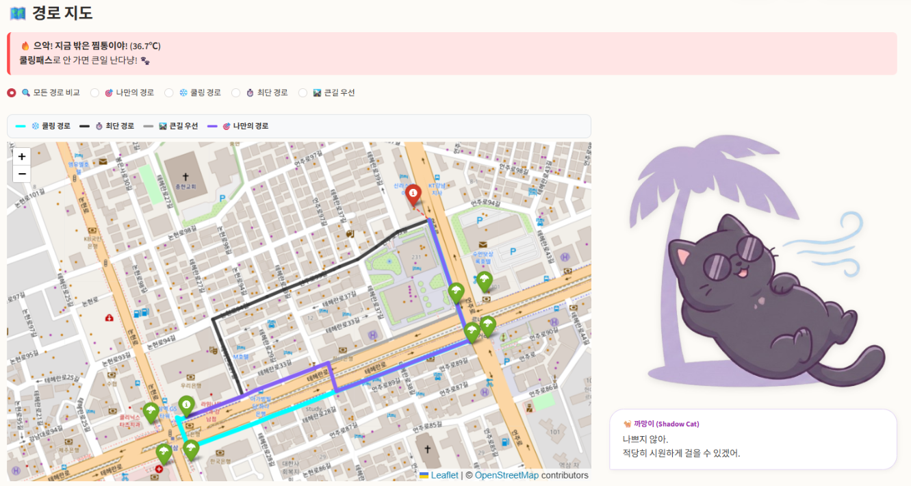

# Cooling Path 🐈‍⬛

### Shade-aware Pedestrian Routing

**서울 강남구 역삼–선릉 일대에서 시간대별 건물 그림자를 반영해 최단 경로와 그늘이 많은 대안 경로를 비교하는 보행 경로 탐색 PoC입니다.**

**태·피·소 — 까망이의 태양 피하기 소동**

폭염 데모의 경로 지도와 네 가지 경로 범례

## Contents

[Overview](#overview) · [Key Results](#key-results) · [Tech Stack](#tech-stack) · [Engineering Decisions & Validation](#engineering-decisions--validation) · [Architecture](#architecture) · [Quick Start](#quick-start) · [Tests & CI](#tests--ci) · [Documentation](#documentation) · [Scope & Limitations](#scope--limitations)

## Overview

폭염에는 거리가 짧은 경로라도 햇빛에 오래 노출될 수 있습니다. Cooling Path는 건물 형상·높이와 태양 위치로 시간대별 그림자를 계산하고, 도로별 그늘 비율을 경로 비용에 반영합니다. 대시보드에서는 최단 경로, 쿨링 경로, 대로 우선 경로, 개인화 경로의 이동 거리·예상 시간·그늘 비율을 비교할 수 있습니다.

### Project Info

| 항목 | 내용 |
| --- | --- |
| 프로젝트 유형 | 디토닉 BX사업본부 1인 현장실습 PoC |
| 주요 역할 | 기획, QGIS 공간 데이터 전처리, 건물 그림자 모델링, 경로 탐색, 대시보드 구현 |
| 분석 지역 | 서울특별시 강남구 역삼–선릉 일대 |
| 공개 구성 | Streamlit 앱, 전처리 스크립트, 자동화 테스트 및 오프라인 QGIS 프로젝트 |

## Key Results

### Current App Demo

폭염 데모에서 개인화 경로는 최단 경로보다 **18.3% 길었고**, 길이 가중 평균 그늘 비율은 **30.3%p 높았습니다**. 최대 우회 허용치는 최단거리의 20%로 설정했습니다. [경로별 요약 카드와 개인화 결과](docs/evaluation.md#current-app-demo)

### Internship Simulation

역삼역 8번 출구에서 KT강남지사까지의 단일 경로 비교입니다.

| 지표 | 기준 경로 | 쿨링 경로 | 차이 |
| --- | ---: | ---: | ---: |
| 거리 | 751.7m | 781.2m | 약 30m |
| 예상 이동 시간 | 11.3분 | 11.7분 | 약 0.4분 |
| 평균 그늘 비율 | 5.5% | 35.0% | +29.5%p |

현장실습 당시 예상 이동 시간 14% 이내의 대안을 찾기 위해 후보 50개를 탐색했습니다. 표의 이동 시간은 시뮬레이션 추정치입니다. 당시 화면에 표시된 평균 그늘 비율의 집계식과 실행 시간대는 현재 공개 기록에서 확인할 수 없습니다. 현재 앱은 도로 링크 길이로 가중한 그늘 비율을 표시합니다. [현장실습 시뮬레이션](docs/evaluation.md#internship-route-comparison)

### Preprocessing Reproduction

공개 가공 데이터를 사용한 전처리 기록에는 건물 1,392개에서 생성한 시간대별 그림자 16,704개와 도로 971개에 대한 링크·시간대 통계 11,652행이 남아 있습니다. 2025년 7월 8일 08:00–19:00 KST에 해당하는 시나리오입니다. 집계 정책의 차이와 비교 결과는 [전처리 검증](docs/qgis-workflow.md#reproduction-checks)에서 확인할 수 있습니다.

## Tech Stack

| 영역 | 기술 | 활용 |
| --- | --- | --- |
| 공간 데이터 | QGIS, GeoPandas, Shapely, PyProj | 분석 영역 정제, 좌표계 변환, 그림자 형상과 도로 버퍼 교차 |
| 태양 위치 | Pysolar | 시간대별 태양 고도와 방위각 계산 |
| 경로 탐색 | NetworkX, SciPy KDTree | 보행 그래프의 최단·가중 경로 탐색, 검색 좌표의 최근접 노드 연결 |
| 데이터 처리 | Pandas | 링크·시간대별 그늘 통계 처리 |
| 애플리케이션 | Streamlit, Folium, Altair | 경로 선택, 지도 표시, 기상 차트 |
| 외부 연동 | Kakao Local API, Open-Meteo, OpenStreetMap | 장소 검색, 기상 조회, 브라우저 지도 배경 |
| 실행·검증 | pytest, Ruff, GitHub Actions, Docker, Dev Container | 자동화 검사와 실행 환경 구성 |

## Engineering Decisions & Validation

| 문제 | 설계 결정 | 검증 근거 |
| --- | --- | --- |
| 오목한 건물의 빈 공간까지 그림자로 처리될 수 있음 | 건물 형상을 태양 반대 방향으로 단계별 이동한 후 합집합 | [그림자 방향·범위 테스트](tests/test_preprocessing.py) |
| 그림자가 겹치는 부분을 건물마다 합산하면 면적이 커짐 | 재현 스크립트에서 교차 형상을 먼저 합집합하는 `union` 적용 | [두 집계 정책의 비교 테스트](tests/test_preprocessing.py) |
| 사용자 요청마다 공간 교차 분석을 수행하는 비용 | 그늘 비율을 미리 집계하고 도로 그래프에 결합 | [데이터 로딩](src/coolingpath/data.py)과 [시간대별 통계 결합](src/coolingpath/routing.py) |
| 우회율을 비교할 공통 기준이 필요함 | 보행 도로 길이의 합이 최소인 경로를 기준으로 개인화 후보 평가 | [최단거리 기준과 우회 제한 테스트](tests/test_routing.py) |
| 같은 두 노드를 연결하는 도로가 단순 그래프에서 겹침 | 최단 링크를 남기고 동률은 `link_id`로 결정. 제외 링크는 그래프에 기록 | [평행 링크 선택 테스트](tests/test_routing.py) |
| 외부 기상 응답에 오류나 비정상 값이 섞일 수 있음 | 응답 구조, 날짜, 시간, 기상값 범위를 확인한 뒤 사용 | [기상 응답 테스트](tests/test_services.py) |
| QGIS 프로젝트를 다른 디렉터리에서 열 수 있어야 함 | 저장소 내부의 레이어를 상대경로로 연결 | [QGZ·GeoPackage 구조 검사](tests/test_qgis_project.py) |

## Architecture

사전 계산은 EPSG:5179에서 수행합니다. 건물 그림자와 2m 도로 버퍼의 교차 면적을 집계해 링크·시간대별 그늘 비율을 계산합니다. 앱은 사전에 집계해 저장한 CSV를 읽어 선형 보행 도로 그래프에 결합합니다.

~~~mermaid
flowchart TB
    A["건물 형상·높이와 태양 위치"] --> B["시간대별 건물 그림자"]
    B --> C["도로 버퍼와 교차·집계"]
    C --> D["링크·시간대별 그늘 통계"]
    D --> E["보행 도로 그래프"]
    F["Kakao 장소 검색·최근접 노드"] --> G["경로 탐색"]
    E --> G
    H["기상·시간대·사용자 설정"] --> G
    G --> I["경로 지도와 비교 지표"]
~~~

앱과 QGIS 도로 색상은 현장실습 방식으로 집계한 공개 CSV를 읽습니다. 전처리 스크립트의 기본 정책 `union`으로 생성한 파일은 지정한 경로에 별도로 저장됩니다. [모듈 구성과 실행 흐름](docs/architecture.md)

## Engineering Highlights

- **그림자 모델링** — 건물 형상을 7구간에 걸쳐 이동하고 원래 위치를 포함한 8개 형상을 합집합합니다. 이동 간격이 크면 그림자 근사에 틈이 생길 수 있습니다.
- **경로 비용과 거리 제약** — 최단 경로는 도로 길이를 사용하고 쿨링 경로는 그늘 부족과 보행 시설의 페널티를 적용합니다. 개인화 모드는 사용자가 설정한 우회 범위 안에서 최대 30개 후보를 검토합니다.
- **경로 비교 지표** — 그늘 비율은 링크 길이로 가중해 평균을 구합니다. 그늘 보정 온도는 `기온 − 길이 가중 평균 그늘 비율 × 5℃`로 계산하는 시뮬레이션 지표입니다.

수식, 비용 정책, 구현상의 한계는 [Engineering Notes](docs/engineering.md)를 참고하세요.

## Quick Start

Python 3.11 이상과 Kakao Local REST API 키가 필요합니다. 가상 환경과 Docker 실행 절차는 [Getting Started](docs/getting-started.md)를 참고하세요.

~~~bash
git clone https://github.com/tangerineYR/cooling-path.git
cd cooling-path
python -m pip install -e .
~~~

macOS·Linux는 `export KAKAO_API_KEY="YOUR_KAKAO_REST_API_KEY"`를, Windows PowerShell은 `$env:KAKAO_API_KEY = "YOUR_KAKAO_REST_API_KEY"`를 실행합니다.

~~~bash
python -m streamlit run app.py
~~~

[http://localhost:8501](http://localhost:8501)에서 시간대와 경로를 선택합니다. 폭염·강수 데모는 고정 기상 시나리오를 사용하며, 장소 검색에는 Kakao API 키와 네트워크 연결이 필요합니다.

## Tests & CI

~~~bash
python -m pip install -e ".[dev,preprocessing]"
python -m pytest -q
ruff check src tests scripts app.py
~~~

[GitHub Actions](.github/workflows/ci.yml)는 `push`와 `pull_request`에서 Python 3.11·3.12로 검사합니다. 테스트는 앱의 초기 화면, 경로 탐색·지표 계산, 기상 응답 처리, 전처리와 QGIS 파일 구조를 확인합니다. QGIS 실행과 렌더링은 [QGIS Usage](docs/qgis/usage.md)의 별도 검증 기록을 참고하세요.

## Project Structure & Reproducibility

| 경로 | 역할 |
| --- | --- |
| [`app.py`](app.py), [`src/coolingpath/`](src/coolingpath/) | Streamlit 진입점, 데이터·서비스·탐색·지표·UI 모듈 |
| [`scripts/preprocessing/`](scripts/preprocessing/) | 태양 위치 계산, 그림자 생성, 도로별 집계 |
| [`scripts/qgis/`](scripts/qgis/) | 공개 QGIS 프로젝트와 레이아웃 생성 |
| [`notebooks/shadow_generation.ipynb`](notebooks/shadow_generation.ipynb) | 현장실습 당시 그림자 전처리 구현 |
| [`data/`](data/README.md) | 원천·가공 데이터와 공개 범위 |
| [`tests/`](tests/) | 앱·경로 탐색·기상·전처리·QGIS 테스트 |

그림자 데이터를 다시 만들려면 [QGIS & Shadow Preprocessing](docs/qgis-workflow.md#reproduce-the-preprocessing)을 참고하세요. QGIS에서 분석 결과를 보려면 저장소 구조를 유지한 채 [`CoolingPath_QGIS.qgz`](docs/qgis/CoolingPath_QGIS.qgz)를 엽니다. 건물, 건물 그림자, 보행 도로, 도로 버퍼를 오프라인으로 확인할 수 있습니다. [QGIS Usage](docs/qgis/usage.md)

## Documentation

| 문서 | 내용 |
| --- | --- |
| [Getting Started](docs/getting-started.md) | 앱 설치·API 설정·Docker 실행 |
| [Architecture](docs/architecture.md) | 모듈 구성과 경로 탐색 흐름 |
| [Engineering Notes](docs/engineering.md) | 그림자 생성과 집계, 경로 비용, 지표의 가정 |
| [Simulation Evaluation](docs/evaluation.md) | 현재 앱 시연, 현장실습 당시 경로 비교, 지표의 해석 범위 |
| [QGIS & Shadow Preprocessing](docs/qgis-workflow.md) | 공간 전처리와 재현 명령 |
| [QGIS Usage](docs/qgis/usage.md) · [QGIS Layer Inventory](docs/qgis/layer-inventory.md) | QGIS 실행, 레이어와 데이터 출처 |
| [Data Guide](data/README.md) | 공개 데이터 파일과 앱 입력 |

### Data Provenance

원천 데이터 수집일은 2026년 1월 5일입니다. 시간별 그림자는 2025년 7월 8일의 태양 위치를 기준으로 계산했습니다.

| 데이터셋 | 제공처 | 활용과 저장소 범위 |
| --- | --- | --- |
| [서울시 자치구별 도보 네트워크 공간정보](https://data.seoul.go.kr/dataList/OA-21208/S/1/datasetView.do) | 서울 열린데이터광장 | 보행 경로 탐색. 원천 CSV와 가공 도로 파일 포함 |
| [서울특별시 강남구_그늘막](https://www.data.go.kr/data/15143202/fileData.do) | 서울특별시 강남구 | 지도 마커. 가공 CSV 포함 |
| [GIS건물통합정보-서울특별시](https://www.vworld.kr/dtmk/dtmk_ntads_s002.do?svcCde=NA&dsId=18) | VWorld | 그림자 생성. 높이 보정을 포함한 가공 파일 제공 |
| [행정경계(시군구)](https://www.vworld.kr/dtmk/dtmk_ntads_s002.do?svcCde=MK&dsId=30252) | VWorld | 분석 영역 설정·클리핑. 원본 SHP 미포함 |
| [방재기상관측(AWS)](https://data.kma.go.kr/data/grnd/selectAwsRltmList.do?pgmNo=56) | 기상청 | 초기 폭염 분석·시각화 기획. 원본 관측 CSV 미포함 |

앱은 [Kakao Local API](https://developers.kakao.com/docs/latest/ko/local/dev-guide)로 장소를 검색하고 [Open-Meteo](https://open-meteo.com/)에서 기온·강수량·상대습도를 가져옵니다. 태양 위치, 그림자 형상, 도로별 그늘 비율은 별도로 계산한 파생 데이터입니다.

## Scope & Limitations

- 공간 범위는 역삼–선릉 일대입니다. 검색 좌표는 가장 가까운 도로 노드에 연결하므로 건물 출입구나 도로 횡단 가능성은 별도로 확인해야 합니다.
- 앱은 2025년 7월 8일 08:00–19:00 KST의 그림자 시나리오를 사용합니다. 실시간 기상 모드는 실행 당일의 기상 예보와 이 고정 그림자 시나리오를 결합합니다. 강수량이 0보다 크면 앱은 경로 계산과 비교 지표에 그늘 비율을 0으로 적용합니다.
- 그림자는 건물 형상을 단계별로 이동시킨 근사값입니다. 현장 그림자 정확도, 이 경로의 실제 보행 시간·기온, 사용자 쾌적성은 측정하지 않았습니다.
- 경로는 같은 노드 쌍당 도로 하나를 남긴 그래프에서 계산하므로 제외된 평행 도로는 후보에 포함되지 않습니다.

## License & Usage

Cooling Path는 디토닉 현장실습에서 개발한 PoC를 포트폴리오와 기술 문서로 공개한 프로젝트입니다. 별도의 오픈소스 라이선스가 부여되어 있지 않습니다. 프로젝트와 외부 데이터·API·이미지의 이용 조건은 [NOTICE](NOTICE.md)를 참고하세요.

지도 배경 © [OpenStreetMap contributors](https://www.openstreetmap.org/copyright).
