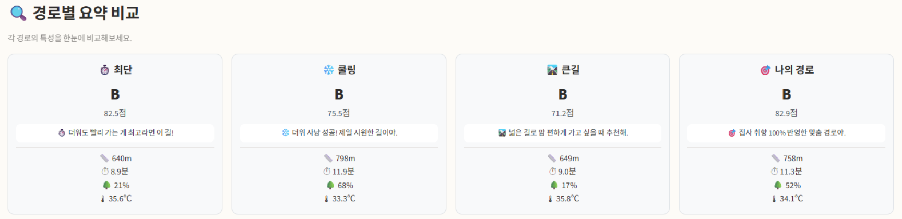
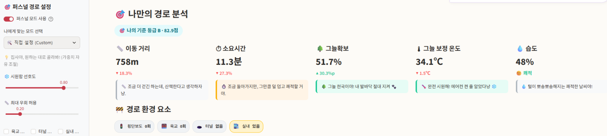

# Simulation Evaluation

## Current App Demo

현재 앱의 폭염 데모에서 역삼역 8번 출구부터 KT플라자 강남점까지의 최단 경로와 개인화 경로를 비교합니다.

| 시연 조건 | 설정 |
| --- | --- |
| 보행 시작 시간 | 14:00 KST |
| 기온 데이터 모드 | 폭염 (demo) |
| 퍼스널 모드 | 직접 설정 (Custom) |
| 시원함 선호도 | 0.8 |
| 최대 우회 허용 | 0.2 · 보행 네트워크 최단거리 대비 최대 20% |
| 시설 회피 | 육교·터널·실내 회피 모두 끔 |

| 지표 | 최단 경로 | 개인화 경로 |
| --- | ---: | ---: |
| 이동 거리 | 640m | 758m |
| 예상 이동 시간 | 8.9분 | 11.3분 |
| 길이 가중 평균 그늘 비율 | 21% | 52% |

표는 위 요약 카드에 표시된 값이며, 그늘 비율은 정수로 반올림되어 있습니다.

상세 카드에서 개인화 경로는 최단 경로보다 **18.3% 길었고**, 20% 거리 한도 이내였습니다. 개인화 경로의 길이 가중 평균 그늘 비율은 **51.7%** 로, 최단 경로보다 **30.3%p** 높았습니다. 차이는 상세 카드에 표시된 값입니다.

폭염 데모는 사전에 정의한 기상값과 2025년 7월 8일의 그림자 시나리오를 사용합니다. [경로 지도와 범례](assets/route-comparison-demo.png)

## Current App Metrics

현재 일반 쿨링 경로는 쿨링 비용이 가장 작은 경로를 탐색합니다. 개인화 모드는 보행 네트워크 최단거리 대비 선택한 우회율을 적용하며 최대 30개 후보를 검토합니다. [현재 탐색 정책](architecture.md#routing-policy)

그늘 비율은 도로 링크 길이로 가중해 평균을 구합니다. `그늘 보정 온도`는 `기온 − 길이 가중 평균 그늘 비율 × 5℃`로 계산하는 시뮬레이션 지표입니다. 시간대별 온도 차트는 선택 시각의 경로 그늘 비율을 고정한 채 시간대별 기온에 적용합니다. 표준 열지수와의 비교 및 현장 온도 검증은 수행하지 않았습니다.

## Internship Route Comparison

현장실습 당시 역삼역 8번 출구에서 KT강남지사까지 한 구간을 대상으로 최단 경로와 쿨링 경로를 비교했습니다. 당시 실행 화면에는 기준 경로의 예상 이동 시간 대비 **14% 이내**를 허용하고 후보 **50개**를 탐색한 기록이 남아 있습니다.

| 지표 | 기준 경로 | 쿨링 경로 | 차이 |
| --- | ---: | ---: | ---: |
| 거리 | 751.7m | 781.2m | 약 30m |
| 예상 이동 시간 | 11.3분 | 11.7분 | 약 0.4분 |
| 평균 그늘 비율 | 5.5% | 35.0% | +29.5%p |

[현장실습 당시 경로 비교 화면](assets/simulation-result.png)

표의 예상 시간과 평균 그늘 비율은 화면에 표시된 시뮬레이션 값입니다. 거리 차이는 화면에서 29.4m로 표기됐고, 화면에 표시된 두 경로 길이를 빼면 29.5m입니다. 표에서는 약 30m로 표기합니다. 선택 시각, 전체 실행 설정과 당시 평균 그늘 비율 집계식은 공개 기록에서 확인할 수 없습니다. 현장 보행 시간·기온, 사용자 행동 변화와 서비스 도입 효과는 측정하지 않았습니다.